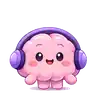

# OneLife — visual reference directory

The 96×96 transparent WebP above is a **small verification thumbnail**, cropped and matted from an earlier generated glossy Brain reminder illustration within the current design discussion. It is not the full-resolution production master and is **not a pixel-perfect reproduction of the most recent user-uploaded board**. The image is for showing the correct volume, catchlights, blush, violet headphones, hand/feet silhouette and cute warm personality. Slight edge cleanup may be needed.

The user's most recent chosen picture remains the canonical art direction. Read [STYLE_LOCK_V2.md](../STYLE_LOCK_V2.md). **Do not train or regenerate assets from the flat SVG v1 masters.** High-resolution source image, complete art variants, and visually approved sprites are still pending.

SHA (Git blob): `1f0ed867825dcbfdd1501736390af98b0aa794b9`. Source extraction date: 2026-11-14.
